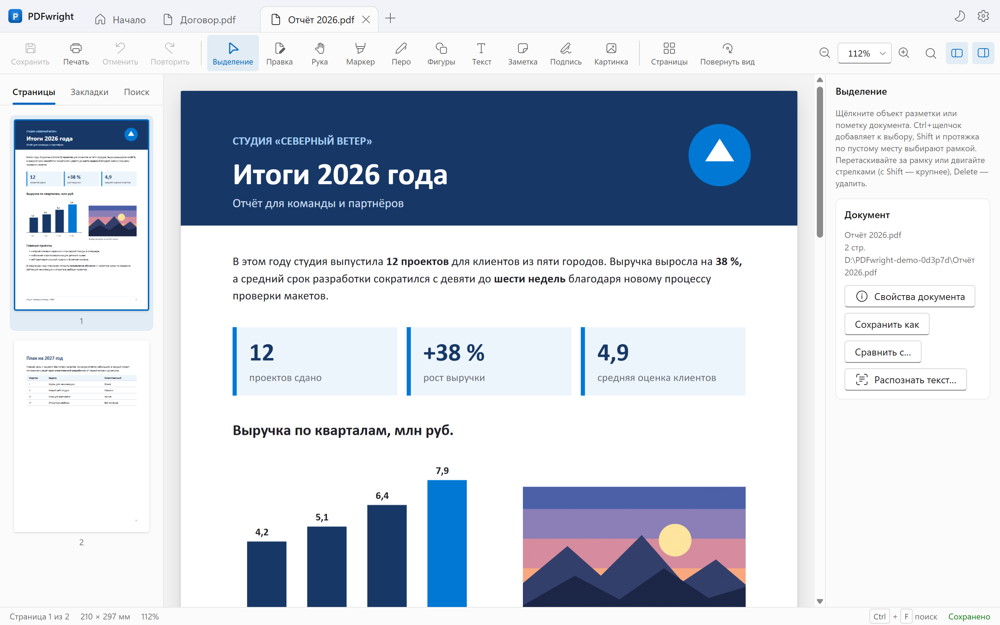
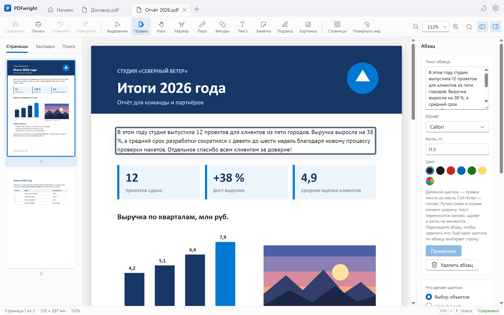
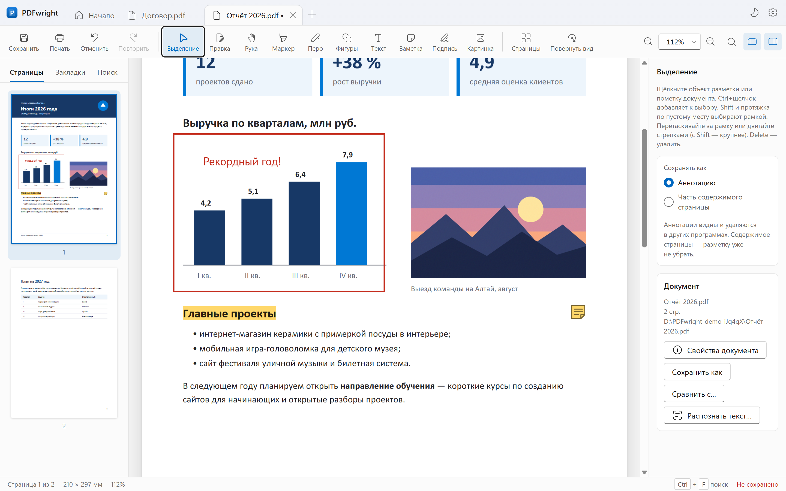
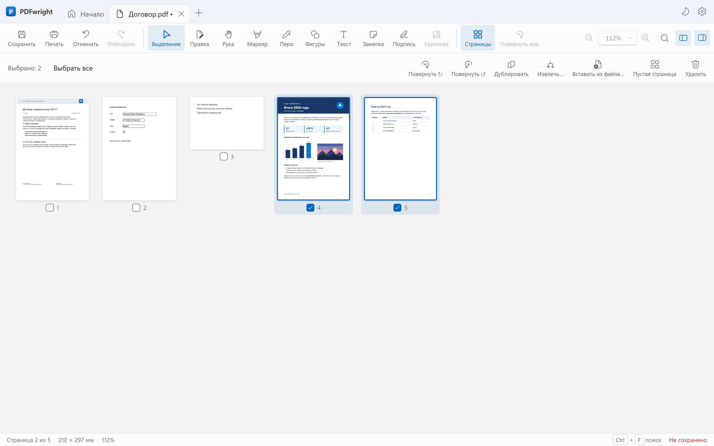
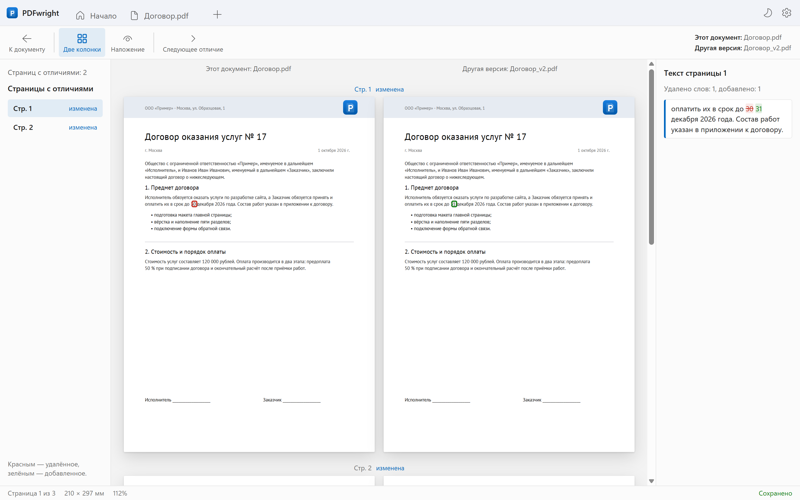
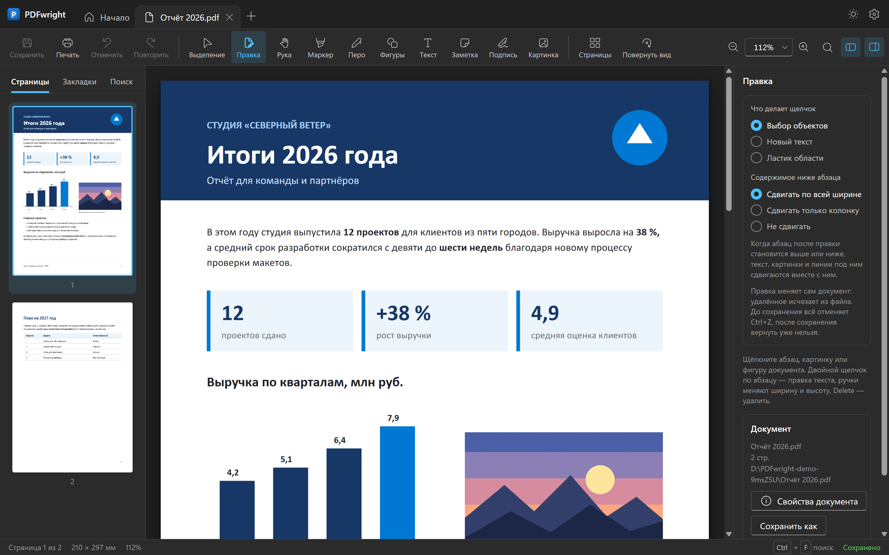

# PDFwright

Программа для просмотра и правки PDF на Windows и Mac. Работает локально: без аккаунтов, рекламы и облака, документы не покидают компьютер.

**[Скачать последнюю версию](https://github.com/iHoooK/PDFwright/releases/latest)**

**Содержание**

- [Что умеет](#что-умеет)
- [Снимки экрана](#снимки-экрана)
- Установка: [Windows](#для-windows) · [Mac](#для-mac)
- [Разработка](#разработка)
- [Приватность и лицензия](#приватность-и-лицензия)
- [Автор](#автор)

## Что умеет

- **Просмотр:** вкладки, миниатюры, закладки, поиск, печать, документы с паролем.
- **Правка документа:** текст тем же шрифтом, что и в файле; удаление и перенос строк, картинок и фигур.
- **Разметка:** маркер, перо, фигуры, текст, заметки, картинки и подпись.
- **Формы и защита:** заполнение PDF-форм, свойства документа, пароль с шифрованием AES-256.
- **Страницы и файлы:** перестановка, поворот, удаление, объединение и разделение.
- **Без интернета:** PDF в картинки и обратно, извлечение текста, сжатие, распознавание сканов, сравнение версий.

Интерфейс на русском и английском, светлая и тёмная тема. Подробности и ограничения — в [RELEASE_NOTES.md](RELEASE_NOTES.md).

## Снимки экрана

<details>
<summary>Показать снимки</summary>

**Просмотр:** миниатюры, закладки, поиск и несколько документов во вкладках.



**Правка текста:** двойной щелчок по абзацу, и текст можно исправить прямо в PDF.



**Разметка:** маркер, рамки, текст и заметки-стикеры.



**Страницы:** перестановка, поворот, удаление и вставка.



**Сравнение:** две версии документа рядом, изменённые слова подсвечены.



**Тёмная тема:** светлая, тёмная или как в системе.



</details>

## Для Windows

Нужна Windows 10 (22H2) или 11, x64.

| Файл                                                                                                                  | Что это                                                                     |
| --------------------------------------------------------------------------------------------------------------------- | --------------------------------------------------------------------------- |
| [PDFwright-Setup-x64.exe](https://github.com/iHoooK/PDFwright/releases/latest/download/PDFwright-Setup-x64.exe)       | Установщик. Windows запросит права администратора                           |
| [PDFwright-Portable-x64.zip](https://github.com/iHoooK/PDFwright/releases/latest/download/PDFwright-Portable-x64.zip) | Переносная версия. Распакуйте в отдельную папку и запустите `PDFwright.exe` |

Что полезно знать:

- **Предупреждение Windows.** У установщика нет цифровой подписи, поэтому SmartScreen может показать «Неизвестный издатель».
- **Значок и файлы `.pdf`.** Значок на рабочем столе и регистрация для `.pdf` включаются в мастере установки, изначально они выключены. Автозапуска нет.
- **Обновления.** Программа проверяет их при запуске и раз в 12 часов, выключается это в **Параметры → Обновления**. Установленная версия скачивает обновление сама и просит подтвердить установку. Переносная показывает ссылку на релиз: распакуйте новый архив в новую папку.
- **Настройки** лежат отдельно, в `%APPDATA%\PDFwright`, и при обновлении сохраняются.
- **Контрольные суммы** — в файле `SHA256SUMS.txt` в каждом релизе.

## Для Mac

Нужна macOS 13 Ventura или новее. Процессор показан в меню Apple → **Об этом Mac**: строка «Чип» с Apple M1, M2 или новее — это Apple Silicon, строка «Процессор» с Intel — это Intel.

| Процессор     | Установка                                                                                           | Переносная версия                                                                                            |
| ------------- | --------------------------------------------------------------------------------------------------- | ------------------------------------------------------------------------------------------------------------ |
| Apple Silicon | [.dmg](https://github.com/iHoooK/PDFwright/releases/latest/download/PDFwright-Mac-AppleSilicon.dmg) | [.zip](https://github.com/iHoooK/PDFwright/releases/latest/download/PDFwright-Portable-Mac-AppleSilicon.zip) |
| Intel         | [.dmg](https://github.com/iHoooK/PDFwright/releases/latest/download/PDFwright-Mac-Intel.dmg)        | [.zip](https://github.com/iHoooK/PDFwright/releases/latest/download/PDFwright-Portable-Mac-Intel.zip)        |

**Установка.** Откройте `.dmg`, перетащите PDFwright в папку «Программы» и извлеките диск PDFwright (кнопка ⏏ в боковом меню Finder). Запускайте программу из «Программ»: из окна `.dmg` она открывается дольше.

**Переносная версия.** Двойной щелчок по `.zip` распакует `PDFwright.app`. Её можно положить в любую папку или на внешний диск.

### Первый запуск

PDFwright не подписан сертификатом Apple, поэтому macOS предупредит, что не может его проверить. Разрешить запуск нужно один раз:

- **macOS 15 и новее.** Откройте PDFwright и нажмите «Готово» в предупреждении. Затем откройте **Системные настройки → Конфиденциальность и безопасность**, прокрутите вниз и нажмите **Всё равно открыть**, подтвердите паролем или Touch ID и ещё раз нажмите **Всё равно открыть**. Кнопка видна около часа после попытки запуска.
- **macOS 13 и 14.** В «Программах» щёлкните PDFwright правой кнопкой (или с нажатой Control) → **Открыть** и в предупреждении ещё раз **Открыть**.

Если macOS пишет, что программа «повреждена», или кнопки нет, выполните в Терминале (укажите путь, где лежит PDFwright):

```bash
xattr -dr com.apple.quarantine /Applications/PDFwright.app
```

### Что полезно знать

- **Обновления.** Программа проверяет их при запуске и раз в 12 часов и ведёт на страницу релиза. Устанавливается обновление вручную: скачайте свой `.dmg`, закройте PDFwright (⌘Q) и перетащите новую версию в «Программы» с заменой. Настройки сохраняются, а разрешить запуск macOS может попросить снова.
- **PDF по умолчанию.** Программой для PDF остаётся «Просмотр». Чтобы все PDF открывались в PDFwright: выберите PDF в Finder → ⌘I → «Открыть в программе»: PDFwright → **Заменить все**.
- **Печать.** На новых macOS окно печати при первом открытии спрашивает, разрешить ли поиск устройств в локальной сети: так система ищет сетевые принтеры. Если на Mac нет ни одного принтера, окно не откроется, а программа подскажет, где его добавить.
- **Удаление.** Закройте PDFwright (⌘Q) и перетащите его из «Программ» в Корзину. Настройки лежат отдельно, в `~/Library/Application Support/PDFwright`, их можно удалить вручную.
- **Контрольные суммы** — в файле `SHA256SUMS-Mac.txt` в каждом релизе.

## Разработка

Сборка из исходного кода, команды и структура проекта — [docs/BUILDING.md](docs/BUILDING.md). Выпуск новых версий — [RELEASING.md](RELEASING.md). Ручная проверка — [docs/MANUAL_CHECK.md](docs/MANUAL_CHECK.md), план работ — [docs/IMPLEMENTATION_PLAN.md](docs/IMPLEMENTATION_PLAN.md).

## Приватность и лицензия

Политика обработки данных — [PRIVACY.md](PRIVACY.md). Код распространяется по лицензии [GNU AGPL-3.0](LICENSE) или более поздней версии: программой можно свободно пользоваться и делиться, а изменённые версии при распространении должны оставаться открытыми под той же лицензией. Перечень сторонних компонентов — [THIRD_PARTY_NOTICES.md](THIRD_PARTY_NOTICES.md).

Copyright © 2026 Promptix.

## Автор

PDFwright делает Promptix. Сайт: [promptix.ru](https://promptix.ru/), Telegram: [@promptix_ru](https://t.me/promptix_ru), YouTube: [@promptix](https://www.youtube.com/@promptix).
