# Ручная проверка PDFwright перед выпуском

Пошаговый обход всей программы. В каждом шаге написано, что сделать и что должно получиться. Снимки сделаны на демо-договоре в окне 1280×800. У вас окно и масштаб могут отличаться, это нормально. Снимки пересобираются командой `npm run build && npm run docs:shots`.

Проверка займёт около часа. Если что-то не совпадает с ожидаемым, запишите номер шага и что увидели.

## 0. Подготовка

1. Соберите программу:

   ```bash
   bash scripts/build-release.sh
   ```

   В папке `build/` появятся `PDFwright-Setup-x64.exe` (установщик) и `PDFwright-Portable-x64.zip` (переносная версия).

2. Установите программу из `PDFwright-Setup-x64.exe`. Подписи кода нет, поэтому SmartScreen может предупредить о неизвестном издателе: «Подробнее» → «Выполнить в любом случае».
3. Подготовьте демо-файлы. Можно взять свои PDF, но удобнее демо-договор, на котором сделаны снимки:

   ```bash
   npx tsx -e "import('./tests/tour/demo.ts').then((m) => m.writeDemoDocuments('.'))"
   ```

   В корне проекта появятся `Договор.pdf` (3 страницы: текст с шапкой и логотипом, анкета с полями формы, скан без текста) и `Договор_v2.pdf` (та же версия с двумя правками для сравнения).

4. Сделайте копию своего резюме и проверяйте раздел 6 на копии.

## 1. Начало и открытие файла

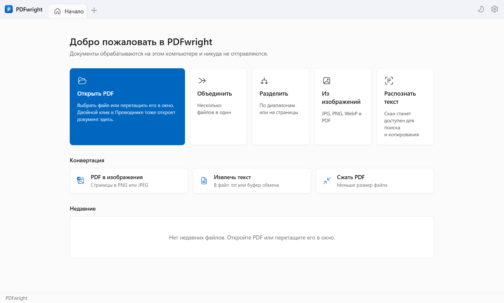

1. Запустите PDFwright без файла. Ожидается стартовый экран: «Открыть PDF», плитки «Объединить», «Разделить», «Из изображений», «Распознать текст», ниже «Конвертация» и «Недавние».
2. Откройте `Договор.pdf`, дважды щёлкнув его в Проводнике. Если PDFwright назначен программой по умолчанию, файл откроется в программе. Иначе выберите «Открыть с помощью → PDFwright».
3. Закройте вкладку, удалите копию файла и щёлкните его в «Недавних». Ожидается сообщение «Файл не найден» и кнопка «Убрать из «Недавних»», а не техническая ошибка.
4. Выделите в Проводнике два PDF и перетащите их на ярлык PDFwright. Оба должны открыться вкладками.

## 2. Просмотр

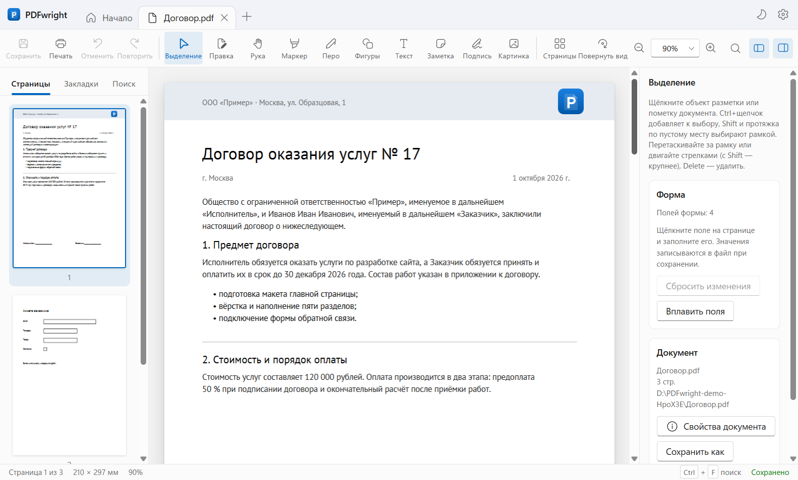

1. Слева миниатюры, справа панель свойств, внизу строка состояния. В строке состояния: «Страница 1 из 3 · 210 × 297 мм · масштаб · Сохранено». Заголовок окна в панели задач — «Договор.pdf — PDFwright».
2. Перейдите на страницу 3 (скан). Размер в строке состояния должен смениться на 210 × 148 мм.
3. Масштаб:
   - Ctrl + колесо мыши, Ctrl+«+», Ctrl+«−» и Ctrl+0 меняют масштаб;
   - поле масштаба принимает своё число, например 137, по Enter;
   - в меню рядом с полем есть «По ширине», «Страница целиком» и готовые значения.
4. «Повернуть вид» (Ctrl+R) поворачивает только отображение. Документ остаётся «Сохранено», миниатюры в режиме «Страницы» не поворачиваются.
5. Вкладка «Закладки»: у договора закладок нет, должно быть написано «В документе нет закладок.»

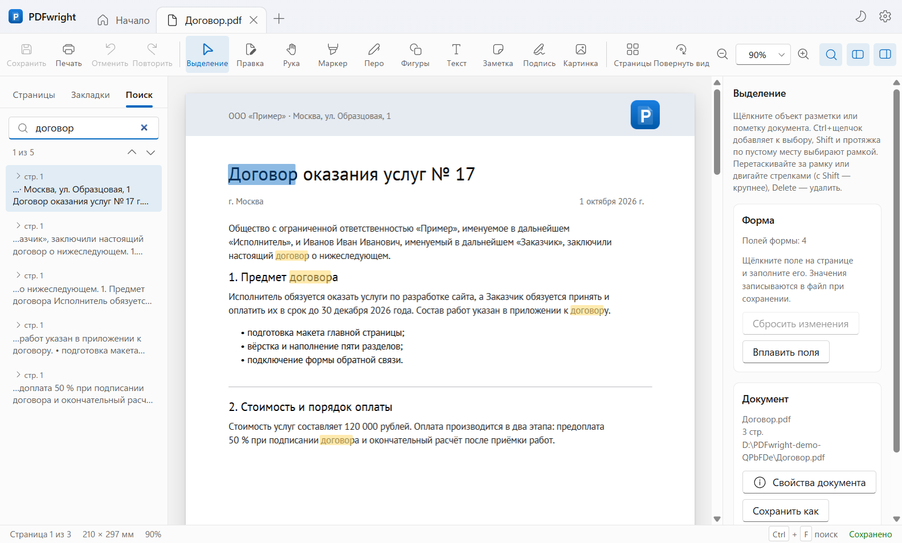

6. Ctrl+F, введите «договор» и нажмите Enter. Найденное подсвечивается, Enter и Shift+Enter переходят между совпадениями. Во фрагментах слова соседних строк не склеены. Esc убирает и результаты, и подсветку.
7. Параметры → Просмотр → «По одной». Колесо мыши, стрелки и пробел у края страницы листают на соседнюю.

## 3. Страницы

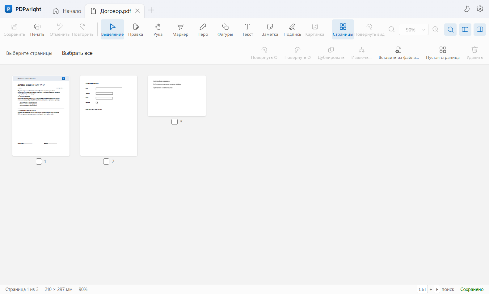

1. Ctrl+G открывает режим «Страницы». Работают выбор щелчком, с Ctrl и с Shift, а также Ctrl+A. Флажок выбора стоит под миниатюрой и не закрывает её.
2. Проверьте «Повернуть ↻/↺», «Дублировать», «Пустая страница», «Вставить из файла», перетаскивание страниц и Delete. Ctrl+Z отменяет каждое действие.
3. Выберите все страницы. Кнопка «Удалить» неактивна, рядом написано «Выбраны все — удалить нельзя».
4. «Извлечь…» сохраняет новый файл и не переключает на него: внизу появляется сообщение с кнопкой «Открыть».
5. «Инструменты → Разделить» дважды подряд в одну и ту же папку. Во второй раз файлы получают имена с « (2)», старые не перезаписываются.

   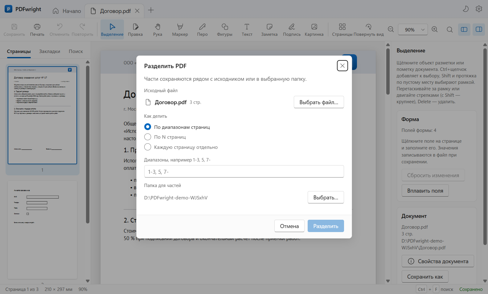

6. «Объединить»: добавьте два файла, поменяйте порядок кнопками «Выше» и «Ниже». Результат открывается сам.
7. Сохраните документ (Ctrl+S), закройте и откройте снова. Порядок, повороты и пустые страницы сохранились.

## 4. Разметка и подпись

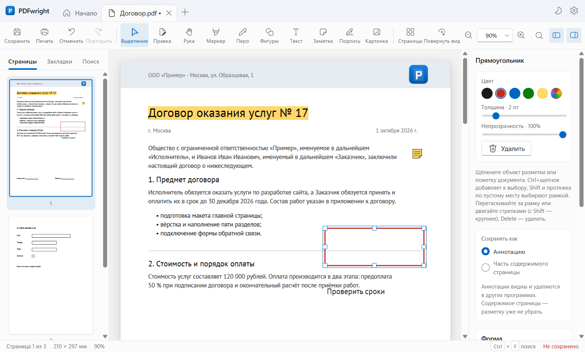

1. **Маркер:** проведите по заголовку, он подсветится жёлтым.
2. **Подчеркнуть и зачеркнуть:** выбираются в панели маркера. Цвет по умолчанию синий и красный соответственно.
3. **Фигуры:** нарисуйте прямоугольник. Чтобы его выбрать, достаточно щёлкнуть внутри. Стрелки двигают фигуру на 1 пт, с Shift — на 10 пт. За край страницы она не уходит.
4. **Текст:** щелчок по странице и набор текста. Длинная строка у правого края переносится по краю страницы. Если стереть весь текст в панели, блок удаляется.
5. **Заметка:** щелчок ставит значок, текст набирается во всплывающем окне. После сохранения заметка видна в других программах, например в Acrobat или Edge, в любом режиме сохранения.
6. В панели свойств выберите «Сохранять как»: «Аннотацию» (можно убрать в другой программе) или «Часть содержимого страницы» (вплавлено навсегда).
7. Миниатюра слева показывает разметку на тех же местах, что и на странице, ещё до сохранения.
8. Кнопки цвета подписаны («Синий», «Красный»), «Свой цвет…» открывает системную палитру.

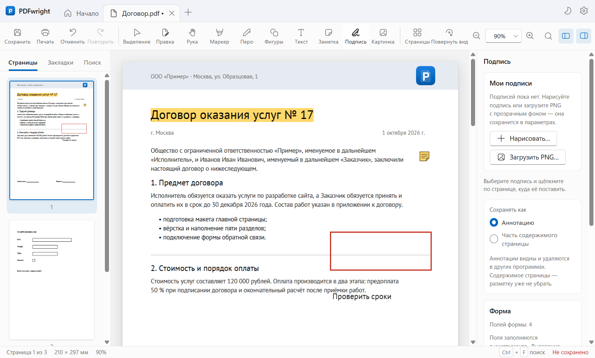

9. **Подпись:** «Нарисовать…». Одиночный щелчок ставит точку, подпись сохраняется в «Мои подписи», плитки не наползают друг на друга. Поставьте подпись на страницу. Картинку и подпись нельзя сжать меньше 16 пт.
10. Сохраните, закройте и откройте файл заново. Пометки на месте. В режиме «Выделение» пометки из файла можно выбрать, перенести, растянуть и удалить. Двойной щелчок по текстовой пометке открывает её правку, у линии из файла есть ручки на концах.

## 5. Правка содержимого документа

Здесь меняется сам документ, а не слой пометок поверх него.

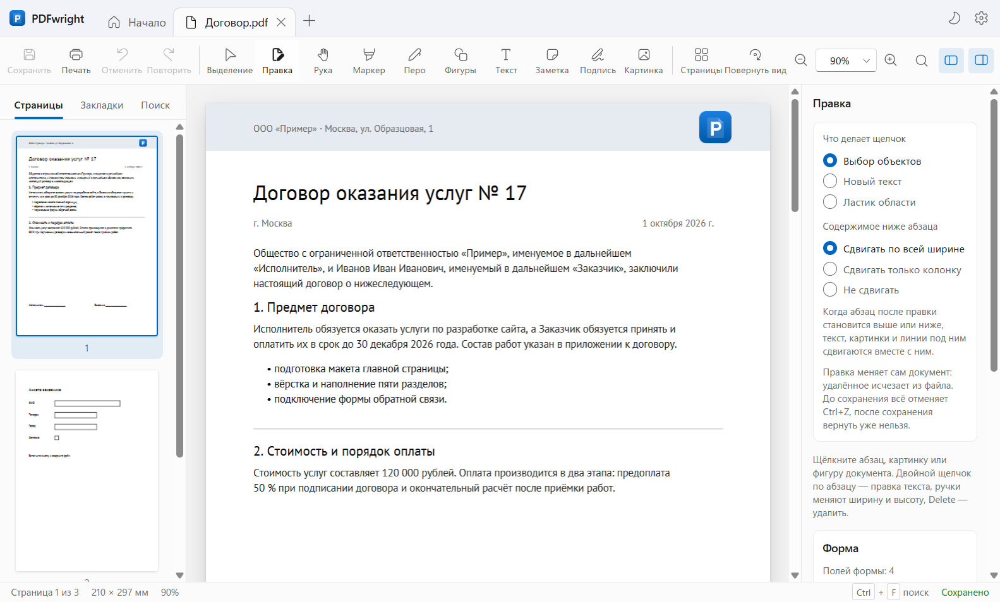

1. Нажмите «Правка». Справа появятся два переключателя. «Что делает щелчок»: «Выбор объектов», «Новый текст», «Ластик области». «Содержимое ниже абзаца»: «Сдвигать по всей ширине», «Сдвигать только колонку», «Не сдвигать».

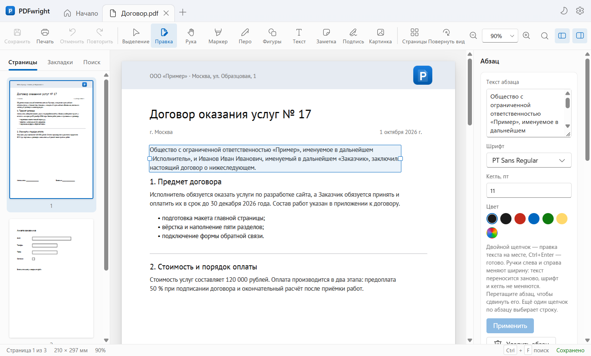

2. Щёлкните абзац: он выбирается целиком, справа появляются шрифт (понятное имя, например «PT Sans Regular»), кегль и цвет. Второй щелчок по выбранному абзацу выбирает строку.
3. Перетащите выбранный абзац за любую его строку: он переносится. Если щёлкнуть без движения, выбирается строка.
4. Выберите красный цвет абзаца. Перекрашиваются все буквы, в том числе жирные слова (проверьте на своём файле с жирным словом в строке).

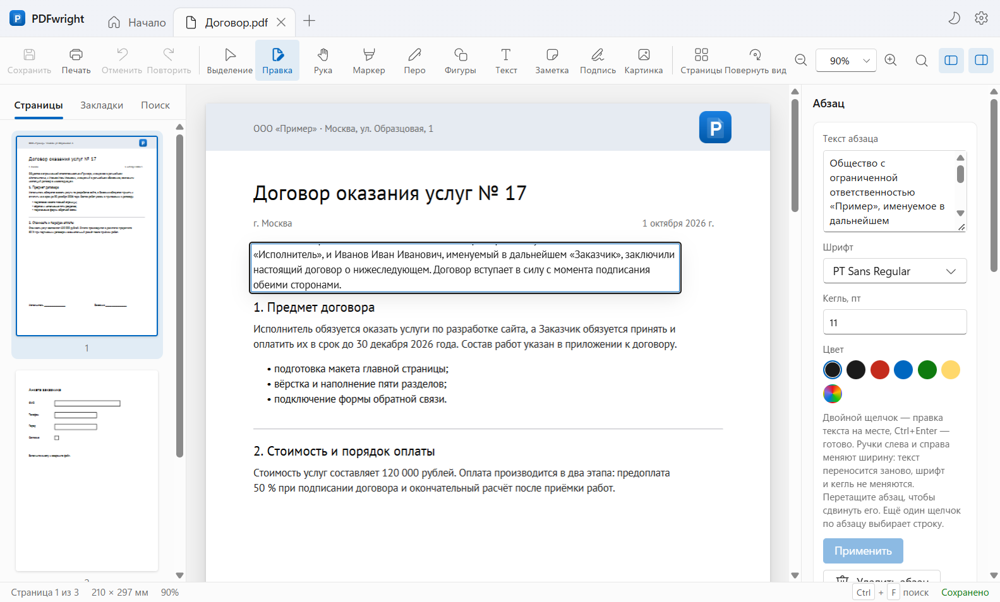

5. Двойной щелчок по абзацу открывает правку на месте. Допишите предложение и нажмите Ctrl+Enter. Esc отменяет правку.

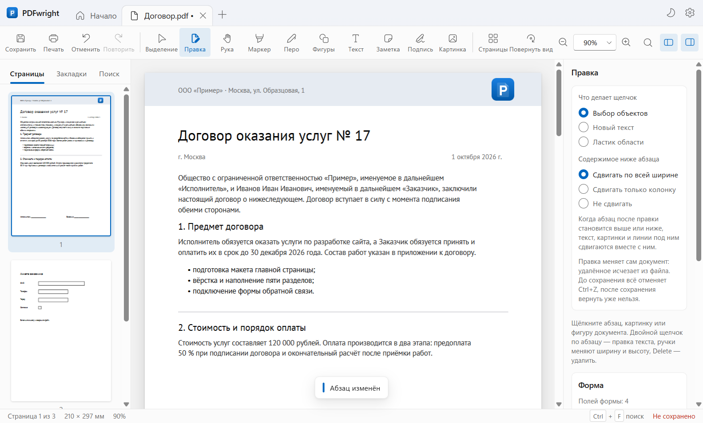

6. Абзац вырос на строку, и всё ниже опустилось вместе с ним: заголовок, список, линия. Строка подписей внизу страницы осталась на месте.
7. Допишите в абзац очень много текста, на полстраницы. Должна появиться ошибка «Абзац не помещается: ниже на странице не хватает места…», а документ не меняется.
8. Ctrl+F «Образцовая» должен найти 1 совпадение. Раньше сдвиг оставлял в файле скрытые копии, и находилось несколько.
9. Удалите абзац клавишей Delete: текст ниже поднимается. Выберите два абзаца (Ctrl+щелчок) и удалите их вместе: текст ниже тоже поднимается.
10. Ручки слева и справа у выбранного абзаца меняют ширину: строки переносятся заново, шрифт и кегль не меняются.

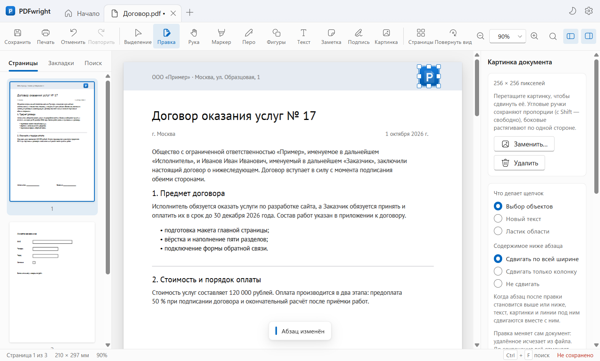

11. Щёлкните логотип в шапке. Его можно перенести, растянуть за угол (пропорции сохраняются, с Shift — свободно), заменить («Заменить…») и удалить. Так же правятся плашка шапки и линия.

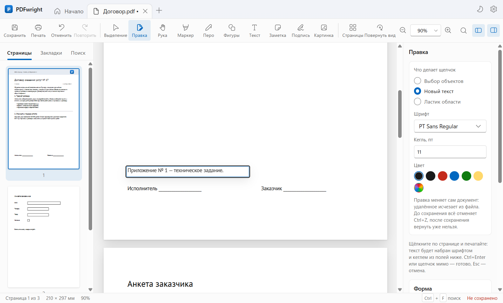

12. «Новый текст»: щёлкните под последним абзацем и печатайте. Поле растёт по тексту. Ctrl+Enter или щелчок мимо применяют. Текст набирается шрифтом документа. Если в шрифте документа нет буквы, например «Ё» или «Щ», она берётся из похожего шрифта того же начертания, а не из Helvetica.
13. «Ластик области»: обведите часть строки, и она вырезается из файла (поиск её больше не находит).
14. Ctrl+Z отменяет каждую правку по шагу. После сохранения отменить уже нельзя, об этом сказано в панели.

## 6. Ваше резюме (на копии)

Снимков здесь нет: в резюме личные данные.

1. Откройте копию резюме и нажмите «Правка».
2. **Изменить текст:** двойной щелчок по абзацу опыта работы, поправьте фразу, Ctrl+Enter. Шрифт и кегль остаются как в документе, жирные слова остаются жирными, текст ниже сдвигается, нижний колонтитул «Резюме обновлено…» остаётся на месте.
3. **Удалить строку:** щелчок по абзацу, второй щелчок по строке, Delete.
4. **Удалить шапку:** щёлкните фото или плашку шапки и нажмите Delete. Текст шапки удаляется по абзацам или ластиком.
5. **Добавить текст:** «Новый текст», щелчок рядом с левым краем абзаца (новый текст прилипает к краю). В панели шрифт документа, например «Go Noto Current Regular», и нужный кегль.
6. Сохраните, закройте и откройте файл снова. Откройте его и в другой программе (Edge, Acrobat): текст выделяется и ищется, лишних копий нет.

## 7. Формы

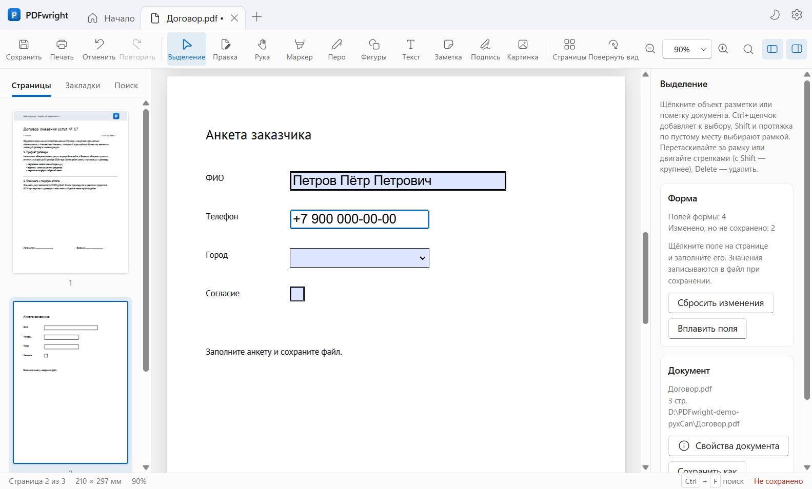

1. На странице 2 заполните ФИО и телефон, выберите город, поставьте флажок. В панели «Форма» показано «Изменено, но не сохранено: N».
2. Ctrl+Z в поле отменяет ввод с первого нажатия.
3. Если поставить и снять флажок, это не считается правкой: статус возвращается к «Сохранено». Так же статус возвращается, если отменить все правки.
4. Нижние части букв «у», «р» в полях не обрезаются.
5. «Вплавить поля» превращает значения в обычный текст страницы. После сохранения в других программах полей больше нет.

## 8. Свойства и пароль

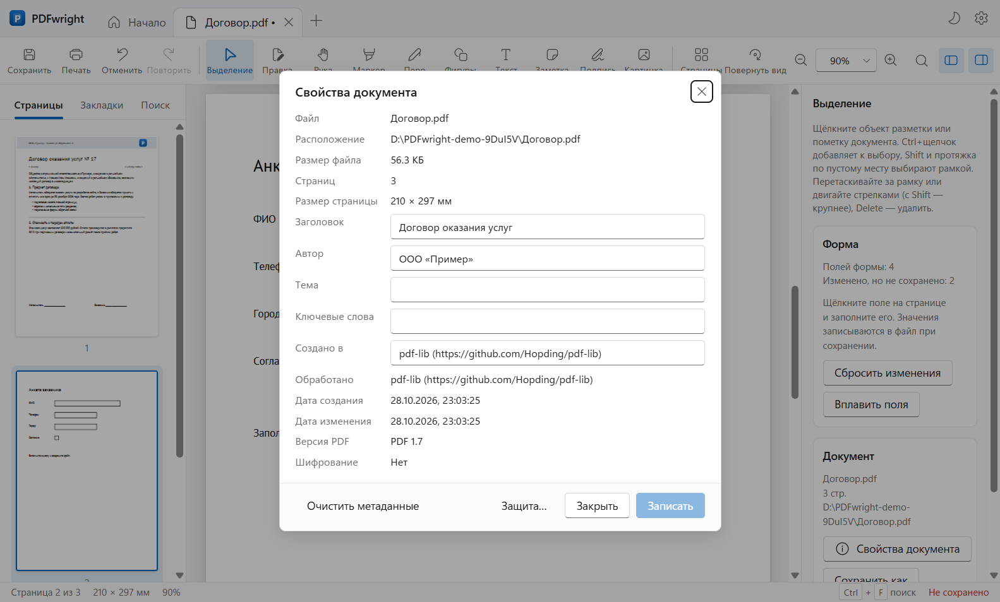

1. «Свойства документа»: название, автор и другие поля. Измените и нажмите «Записать», затем сохраните документ. Повторное открытие свойств показывает новые значения, шифрование — без надписи «будет записано при сохранении».

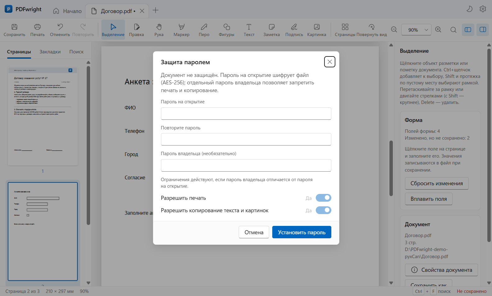

2. «Файл → Защита паролем…»: задайте пароль на открытие и отдельный пароль владельца, запретите печать и копирование. Сохраните документ.
3. Откройте файл заново. Программа спрашивает пароль. Если ввести пароль на открытие, печать и копирование запрещены с понятным сообщением. Если ввести пароль владельца, ограничений нет.
4. «Сменить пароль»: если оставить новый пароль владельца пустым, прежний пароль владельца и запреты сохраняются. Неверный пароль владельца даёт сообщение «Это не пароль владельца документа.»
5. «Снять защиту» с паролем владельца: после сохранения файл открывается без пароля.

## 9. Конвертация, распознавание, сравнение

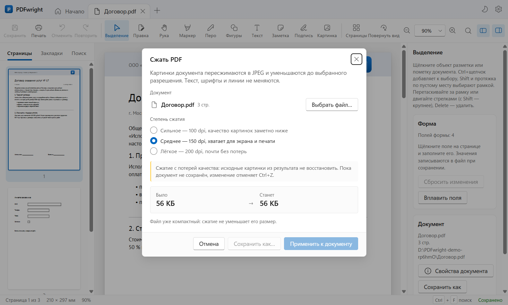

1. «Сжать PDF»: показывает ожидаемый выигрыш. Если выигрыш меньше 1 %, применять нечего. Выбранная степень сжатия запоминается.

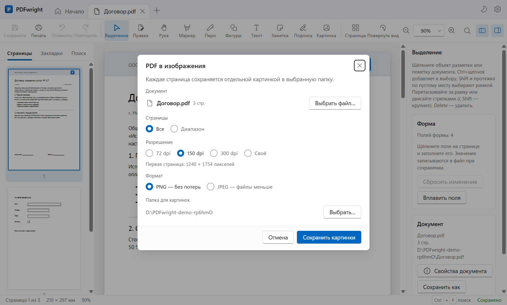

2. «PDF в изображения» дважды в одну папку. Во второй раз имена с « (2)», ничего не перезаписано.
3. «Из изображений» (плитка на стартовом экране): маленькая картинка встаёт в центр A4 в своём размере и не растягивается.
4. Конвертация зашифрованного файла через «Выбрать файл…» спрашивает пароль. Повреждённый файл даёт «Файл не является PDF или повреждён.»

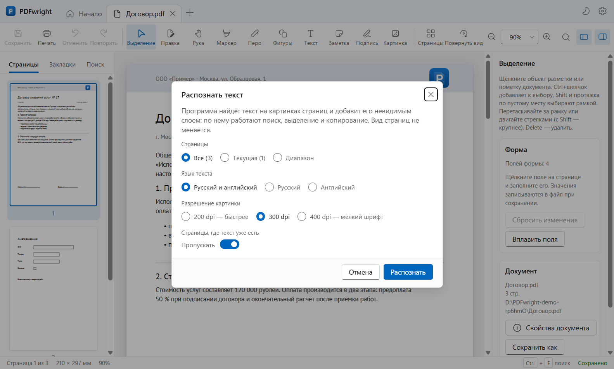

5. «Распознать текст» (плитка на стартовом экране или кнопка в панели «Документ») на странице 3 договора. После распознавания поиск находит «Акт приёма-передачи», текст выделяется и копируется. Если включить «Распознавать тоже» для страниц, где текст уже есть, диалог предупреждает о дублях.

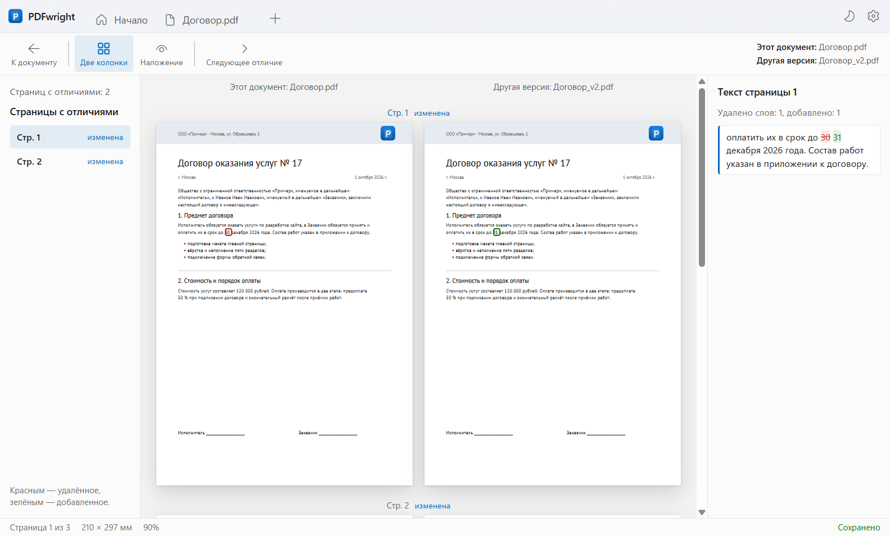

6. В панели «Документ» нажмите «Сравнить с…» и выберите `Договор_v2.pdf`. Отличия на страницах 1 («30» → «31») и 2. «Следующее отличие» начинает с текущей страницы. Строка состояния показывает страницу сравнения. «Анкету» и «анкету,» не считаются разными словами, отдельно отмечается только запятая.

## 10. Окна, параметры, язык

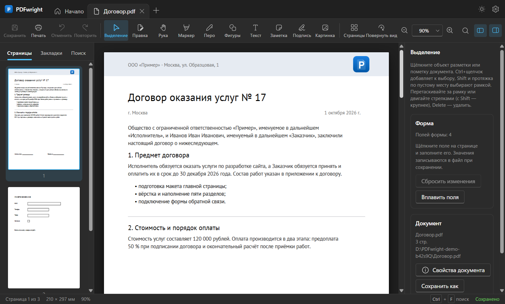

1. Тёмная тема: кнопка с луной вверху справа. Все экраны читаются.
2. Правый щелчок по вкладке → «Открыть в новом окне». У двух окон в панели задач разные заголовки.
3. Закройте окно с несохранёнными правками: программа предлагает «Отмена», «Не сохранять» и «Сохранить».
4. Закройте программу с двумя окнами и откройте снова. Окна и вкладки восстановились.

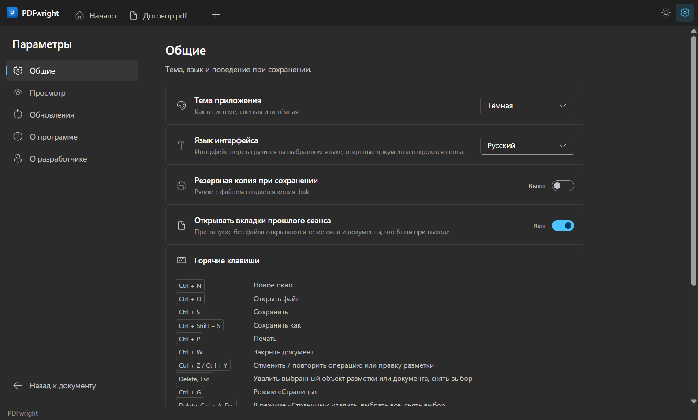

5. Параметры → «Язык интерфейса» → English. Интерфейс перезагружается на английском, документы открываются снова. «Лицензии и приватность» показывает отрисованный текст (заголовки, таблицы) на английском. «Copy diagnostics» тоже на английском. Верните русский.
   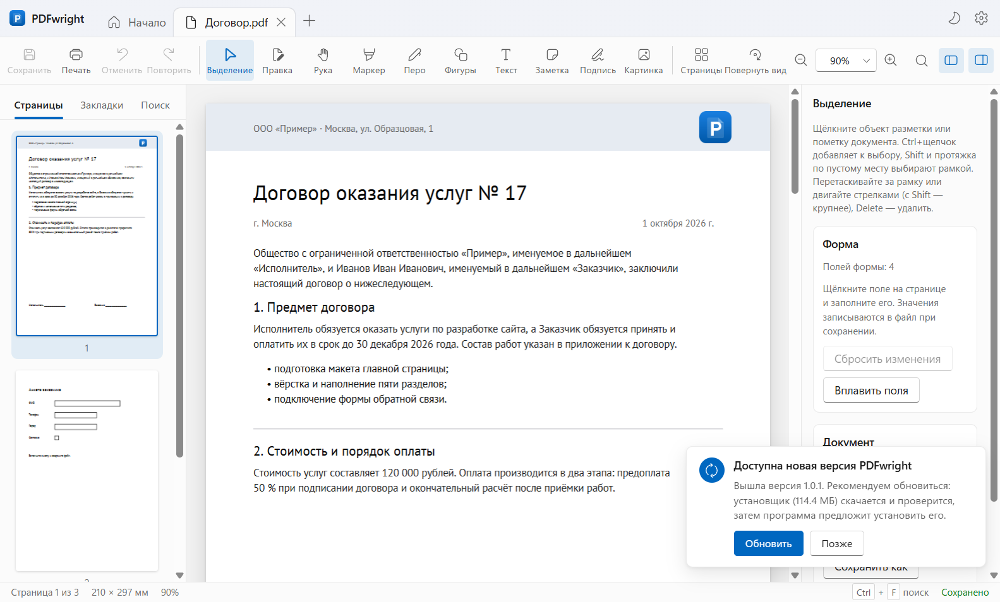

6. «О программе»: версия, «Windows x64». «Обновления» → «Проверить обновления» в установленной версии обращается к GitHub. «Проверять обновления автоматически» включено: когда выйдет версия новее установленной, примерно через 10 секунд после запуска в правом нижнем углу появится «Доступна новая версия PDFwright» с кнопками «Обновить» и «Позже».
   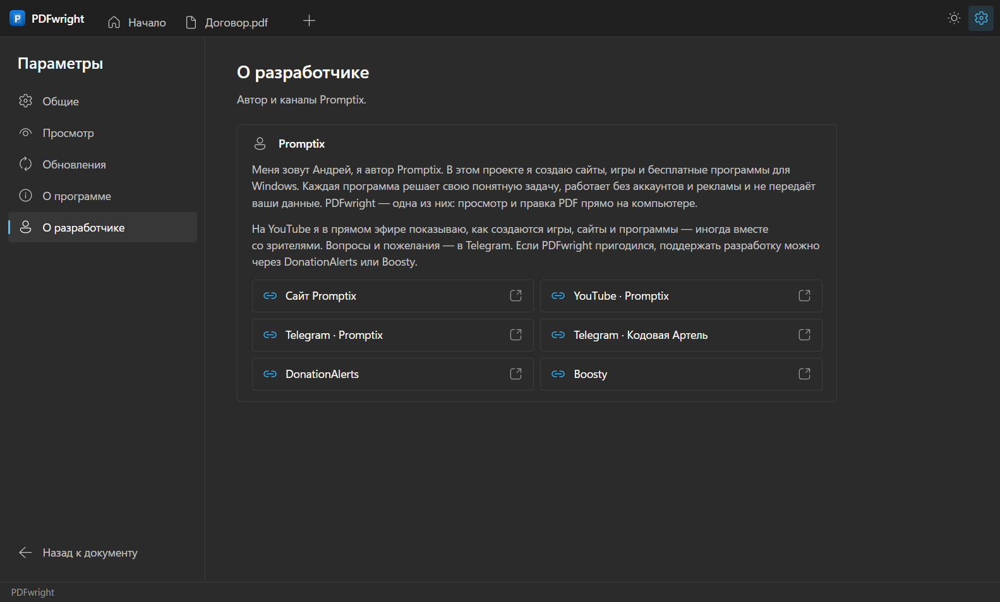

7. «О разработчике»: текст об авторе Promptix и ссылки на сайт, YouTube, Telegram, DonationAlerts и Boosty.
8. На вкладке «Начало» строка состояния не показывает данные скрытого документа.

## 11. Удаление программы

1. «Параметры Windows → Приложения → PDFwright → Удалить». Программа удаляется, ярлыки исчезают.

## 12. На настоящем Mac

Этот раздел нужен только для Mac-версии. Он про то, что Mac-машины GitHub проверить не могут: предупреждение macOS при первом запуске, Finder, Dock, строку меню, тачпад и печать. Всё остальное (открытие, правка, разметка, формы, сохранение) работает тем же кодом и проверяется автоматически, поэтому разделы 1–10 на Mac проходить не обязательно.

Понадобится Mac с macOS 13 или новее, около 40 минут и пара любых PDF. Клавиши в тексте: ⌘ — Command, ⌥ — Option, ⌃ — Control, ⇧ — Shift. Если что-то не совпало, запишите номер шага (например, 12.3.2) и что увидели. Снимок экрана — ⇧⌘4, затем выделите нужную часть экрана: файл появится на рабочем столе.

Какой у вас процессор, написано в меню Apple → **Об этом Mac**: «Чип Apple M…» — это Apple Silicon, «Процессор Intel» — Intel.

### 12.1. Первый запуск и предупреждение macOS

Файл нужно именно скачать браузером: предупреждение появляется только у файлов из интернета. Копия с флешки или через AirDrop проверку не заменит.

1. Скачайте браузером `PDFwright-Mac-AppleSilicon.dmg` или `PDFwright-Mac-Intel.dmg` для своего процессора и `SHA256SUMS-Mac.txt`.
2. В Терминале выполните `shasum -a 256 ~/Downloads/PDFwright-Mac-*.dmg`. Сумма должна совпасть со строкой этого файла в `SHA256SUMS-Mac.txt`.
3. Дважды щёлкните `.dmg`. Ожидается окно: слева значок PDFwright, стрелка, справа папка «Программы» (подпись может быть английской — Applications). Окна с лицензией нет.
4. Перетащите PDFwright на «Программы». Закройте окно и извлеките диск PDFwright (⏏ в боковом меню Finder).
5. Откройте «Программы» и дважды щёлкните PDFwright. Дальше зависит от версии macOS:
   - **macOS 15 и новее.** Появляется сообщение, что macOS не может проверить программу. В нём есть кнопки «Готово» и «Переместить в Корзину». Нажмите «Готово». Откройте **Системные настройки → Конфиденциальность и безопасность**, прокрутите вниз: там есть строка про PDFwright и кнопка **Всё равно открыть**. Нажмите её, подтвердите паролем или Touch ID и ещё раз нажмите **Всё равно открыть**. Программа запускается.
   - **macOS 13 и 14.** Появляется похожее сообщение без кнопки «Открыть». Нажмите «Отмена». Щёлкните PDFwright правой кнопкой (или с нажатой ⌃) → **Открыть** и в новом окне ещё раз **Открыть**. Программа запускается.
6. Завершите программу (⌘Q) и снова откройте двойным щелчком. Ожидается запуск без предупреждений.
7. Запишите, если macOS написала, что программа **повреждена**: этого быть не должно. Запасной путь (команда `xattr` из README, раздел «Первый запуск») снимет отметку, но о самом сообщении всё равно нужно знать.

### 12.2. Запуск прямо из окна .dmg

Многие запускают программу прямо из окна `.dmg`, не перетаскивая её. Работать это должно, хотя обычный путь — из «Программ». Mac-машины GitHub проверили запуск с образа, но не двойной щелчок в Finder с предупреждением macOS, а настолько же долгое ожидание, как на этих машинах, на настоящем Mac никто не мерил.

1. Если копия в «Программах» открыта, завершите её (⌘Q). Перезагрузите Mac: так диск не держит программу в памяти, и замер будет честным.
2. Дважды щёлкните `.dmg`. В его окне дважды щёлкните PDFwright и засеките время. Если macOS предупредит, разрешите запуск, как в 12.1.
3. Запишите, через сколько секунд появилось окно программы. Значок в Dock появится раньше окна: пока окна нет, это ещё не зависание. На Mac-машинах GitHub (они намного медленнее настоящего Mac) окно появлялось через время от полуминуты до полутора минут. Если окна нет дольше 2 минут или macOS пишет «Программа не отвечает», это ошибка: запишите.
4. В окне откройте PDF, поправьте и сохраните его через «Сохранить как» в папку «Загрузки». Ошибок нет.
5. Завершите программу (⌘Q) и извлеките диск PDFwright. Если диск не извлекается сразу, подождите несколько секунд: система ещё закрывает программу.
6. Перетащите PDFwright из окна `.dmg` в «Программы», заменив прежнюю копию. Копирование занимает секунды.

### 12.3. Finder и Dock

1. Значок в Dock такого же размера, как у соседних программ, без серой подложки. При запущенной программе под ним точка.
2. В строке меню слева написано **PDFwright**, а не Electron.
3. Завершите программу (⌘Q). В Finder щёлкните PDF правой кнопкой → **Открыть в программе**. В списке есть PDFwright, а программой по умолчанию остаётся «Просмотр». Выберите PDFwright: программа запускается и сразу показывает этот файл.
4. Не закрывая программу, откройте так же другой PDF. Он появляется новой вкладкой того же окна, второе окно не открывается.
5. Выделите в Finder два PDF и перетащите их на значок PDFwright в Dock. Оба открываются вкладками. Повторите при завершённой программе: она запускается и показывает оба файла.
6. Нажмите красную кнопку окна. Окно закрывается, программа остаётся: точка под значком не пропадает, в строке меню по-прежнему PDFwright.
7. Щёлкните значок в Dock. Открывается новое пустое окно на вкладке «Начало», закрытые документы сами не возвращаются.
8. Откройте файл, завершите программу (⌘Q) и запустите снова. Вкладки того окна, которое было открыто последним, восстанавливаются, лишних пустых окон нет.
9. По желанию: PDF → **Файл → Свойства** (⌘I) → «Открыть в программе»: PDFwright → **Заменить все**. Теперь PDF открываются двойным щелчком в PDFwright. Верните «Просмотр» тем же способом.
10. В программе разделите документ на части («Инструменты → Разделить PDF») и нажмите **Показать в Finder**. Открывается окно Finder с выделенным файлом.

### 12.4. Окно и шапка

1. Кнопки окна (красная, жёлтая, зелёная) находятся в нашей шапке слева, на одной линии с логотипом, и ни с чем не перекрываются.
2. Потяните окно за пустое место шапки: окно двигается. Потяните за вкладку: окно не двигается, вкладка ведёт себя как вкладка.
3. Дважды щёлкните пустое место шапки: окно разворачивается или сворачивается в Dock, как настроено в **Системные настройки → Рабочий стол и Dock**.
4. Смахните тремя пальцами вверх (Mission Control): окно PDFwright видно с заголовком-именем файла.
5. Зелёная кнопка или ⌃⌘F: полноэкранный режим. Отступ слева под кнопками окна исчезает, вкладки сдвигаются к левому краю. Наведите курсор на верх экрана: выезжает строка меню, вкладки не перекрыты так, что по ним нельзя щёлкнуть. Выйдите тем же сочетанием: отступ вернулся.

### 12.5. Меню

1. Меню **PDFwright**: «О программе PDFwright», «Параметры…» (⌘,), «Службы», «Скрыть PDFwright» (⌘H), «Скрыть остальные» (⌥⌘H), «Показать все», «Завершить PDFwright» (⌘Q). Попробуйте каждый пункт.
2. «О программе PDFwright» открывает раздел «О программе» в Параметрах. Там написано `macOS · Apple Silicon` или `macOS · Intel`, слова Windows нет.
3. Меню **Правка**: «Отменить», «Повторить», «Вырезать», «Копировать», «Вставить», «Выделить всё», «Найти». Меню **Окно**: «Свернуть» (⌘M), «Изменить масштаб», «Все окна — на передний план» и список открытых окон.
4. Меню **Справка**: сверху поле поиска macOS. Наберите «масштаб»: система находит пункты меню.
5. Пройдитесь по подсказкам в программе: на кнопках, в таблице сочетаний (Параметры), в подсказках панели свойств нет слов Ctrl и «Проводник», а есть ⌘, delete и Finder.

### 12.6. Клавиши в полях и в документе

Mac-машины GitHub нажимали ⌘A, ⌘C, ⌘V и ⌘Z настоящими нажатиями через систему, но на чужой клавиатуре, с одной раскладкой и только в поле поиска и на странице. Здесь остальное.

1. В другой программе (например, в Заметках) скопируйте строку. В PDFwright вставьте её (⌘V) в каждое поле: поиск (⌘F), пароль в «Защите паролем», текст заметки, текст абзаца в режиме «Правка», поле анкеты в PDF с формой. Текст вставляется только в это поле, документ не меняется.
2. В этих же полях: ⌘A выделяет текст поля, а не всю страницу, ⌘X вырезает, ⌘Z отменяет набор, ⇧⌘Z возвращает. Страницы документа при этом не отменяются.
3. На странице выделите мышью строку, нажмите ⌘C и вставьте в Заметки. Текст совпадает, кириллица не испорчена.
4. В режиме «Страницы» (⌘G) поверните страницу и сделайте её копию. Вернитесь (⌘G) и нажмите ⌘Z один раз: отменяется только копия, поворот остаётся. Ещё раз ⌘Z: отменяется поворот. ⇧⌘Z возвращает их по одному.
5. Откройте PDF с запретом копирования (его можно сделать в «Защите паролем»: пароль на открытие, отдельный пароль владельца, выключить «Разрешить копирование»). Откройте файл паролем на открытие, выделите текст и нажмите ⌘C. Появляется подсказка, что владелец запретил копирование. В Заметках вставляется то, что было в буфере раньше.
6. Переключите клавиатуру на **русскую раскладку** и повторите ⌘S, ⌘O, ⌘F, ⌘Z, ⌘C, ⌘V, ⌘A, ⌘G, ⌘W. Всё работает так же, как на английской. Этого Mac-машины GitHub не проверяли.
7. ⌘N — новое окно. ⌘W — закрыть документ. ⌘Q при несохранённых правках спрашивает, сохранить ли их.

### 12.7. Тачпад и мышь

1. Прокрутка двумя пальцами плавная, по инерции. Страницы рисуются без пустых полос, которые не исчезают.
2. Щипок двумя пальцами меняет масштаб, документ не дёргается. То же делает ⌃ + колесо мыши, если мышь есть.
3. Щелчок двумя пальцами (или с нажатой ⌃) по вкладке документа открывает её меню.
4. В режиме «Выделение» ⌘-щелчок добавляет объект к выбору, щелчок с ⌃ работает как правый щелчок и выбор не меняет.
5. В режиме «Страницы» (⌘G): ⌘-щелчок добавляет страницу, ⇧-щелчок выбирает диапазон, delete удаляет выбранные, ⌘A выбирает все.
6. Перетащите PDF из Finder в окно: файл открывается вкладкой.

### 12.8. Печать

Mac-машины GitHub проверили только окно печати на виртуальном принтере: оно открывается, Esc закрывает его без ошибки. Бумагу и содержимое страниц там не проверить.

1. Откройте многостраничный PDF, нажмите ⌘P. За пару секунд появляется системное окно «Печать» с вашим принтером и кнопкой **PDF** внизу.
2. Нажмите **PDF → Сохранить как PDF** и сохраните в «Загрузки». Откройте результат: страниц столько же, как в документе, текст выделяется, ничего не обрезано. Проверьте и страницу с разметкой после сохранения.
3. Напечатайте на настоящем принтере, если он есть. В выпуске проверьте поля и масштаб.
4. Снова ⌘P и кнопка **Отменить**. Сообщения об ошибке нет, окно программы работает дальше.
5. Поправьте документ и, не сохраняя, нажмите ⌘P. Программа просит сначала сохранить, как и в Windows.
6. **Если на Mac не настроено ни одного принтера** (проверьте в **Системные настройки → Принтеры и сканеры**), окно печати не появляется, а внизу программы видно сообщение «Печать не выполнена» с техническим текстом на английском про отсутствие принтеров. Так и должно быть в этой версии, но сохранить в PDF через печать без принтера нельзя. Запишите, мешает ли это: исправление возможно в версии 1.0.1.

### 12.9. Обновление по ссылке

Полностью проверить можно, только когда выйдет версия новее установленной.

1. **Параметры → Обновления → Проверить обновления**: при последней версии программа сообщает, что установлена актуальная. Ошибки нет.
2. Когда выйдет новая версия: примерно через 10 секунд после запуска появляется «Доступна новая версия PDFwright» с текстом про `.dmg` и кнопкой **Открыть страницу релиза**. Кнопки «Обновить» нет, сама программа ничего не скачивает.
3. Кнопка открывает страницу релиза в браузере. Скачайте `.dmg`, завершите программу (⌘Q), перетащите PDFwright в «Программы» и подтвердите замену. Настройки и «Недавние» сохранились. macOS может снова спросить разрешение, как в 12.1.

### 12.10. Версия для Intel на Apple Silicon

Только если у вас Mac с Apple Silicon. На Mac-машинах GitHub эта связка не запускалась.

1. Скачайте `PDFwright-Portable-Mac-Intel.zip`, распакуйте и положите `PDFwright.app` на рабочий стол. Основную версию сначала завершите (⌘Q).
2. Запустите, разрешите запуск, как в 12.1. Если Rosetta ещё не установлена, macOS предложит её поставить: согласитесь.
3. Ожидается обычное окно. В «О программе» написано `macOS · Intel`. В **Мониторинге системы**, колонка «Тип» или «Архитектура», у PDFwright указано Intel.
4. Откройте большой PDF, прокрутите, поправьте и сохраните. Работает медленнее обычной версии, но без ошибок.

### 12.11. Переносная версия на внешнем диске

На Mac-машинах GitHub внешнего диска нет.

1. Скачайте `PDFwright-Portable-Mac-…zip` для своего процессора, распакуйте двойным щелчком.
2. Перетащите `PDFwright.app` на флешку или внешний диск. Запустите оттуда, разрешите запуск, как в 12.1. Программа открывается.
3. Откройте и сохраните PDF. Настройки лежат не на диске, а в `~/Library/Application Support/PDFwright`.
4. Если диск отформатирован в exFAT или FAT32, а macOS пишет про ошибку подписи или программа не стартует, запишите это отдельно: подпись macOS хранит рядом с файлами, и такие диски могут её портить.
5. Завершите программу и извлеките диск. Значок в Dock исчез, сообщений об ошибках нет.

### 12.12. Тема и язык системы

1. Включите в **Системные настройки → Оформление** тёмный режим. Если в программе в «Параметрах» выбрана системная тема, она становится тёмной без перезапуска. Кнопки окна и строка меню тоже тёмные.
2. Смените в Параметрах язык на English: меню Mac (PDFwright, File, Edit, Window, Help) и подсказки на английском. Верните русский.

### 12.13. Удаление

1. Завершите программу (⌘Q) и перетащите PDFwright из «Программ» в Корзину. В Dock значка больше нет.
2. Папка настроек остаётся: `~/Library/Application Support/PDFwright` (⇧⌘G в Finder). Удалите её, если нужно убрать всё. PDF при этом не затрагиваются.
