# Ручная проверка PDFwright перед выпуском

Пошаговый обход всей программы. В каждом шаге написано, что сделать и что должно получиться. Снимки сделаны на демо-договоре в окне 1280×800. У вас окно и масштаб могут отличаться, это нормально. Снимки пересобираются командой `npm run build && npm run docs:shots`.

Проверка займёт около часа. Если что-то не совпадает с ожидаемым, запишите номер шага и что увидели.

## 0. Подготовка

1. Соберите программу:

   ```bash
   bash scripts/build-release.sh
   ```

   В папке `build/` появятся `PDFwright-Setup-x64.exe` (установщик) и `PDFwright-Portable-x64.zip` (переносная версия).

2. Установите программу из `PDFwright-Setup-x64.exe`. Подписи кода нет, поэтому SmartScreen может предупредить о неизвестном издателе: «Подробнее» → «Выполнить в любом случае».
3. Подготовьте демо-файлы. Можно взять свои PDF, но удобнее демо-договор, на котором сделаны снимки:

   ```bash
   npx tsx -e "import('./tests/tour/demo.ts').then((m) => m.writeDemoDocuments('.'))"
   ```

   В корне проекта появятся `Договор.pdf` (3 страницы: текст с шапкой и логотипом, анкета с полями формы, скан без текста) и `Договор_v2.pdf` (та же версия с двумя правками для сравнения).

4. Сделайте копию своего резюме и проверяйте раздел 6 на копии.

## 1. Начало и открытие файла

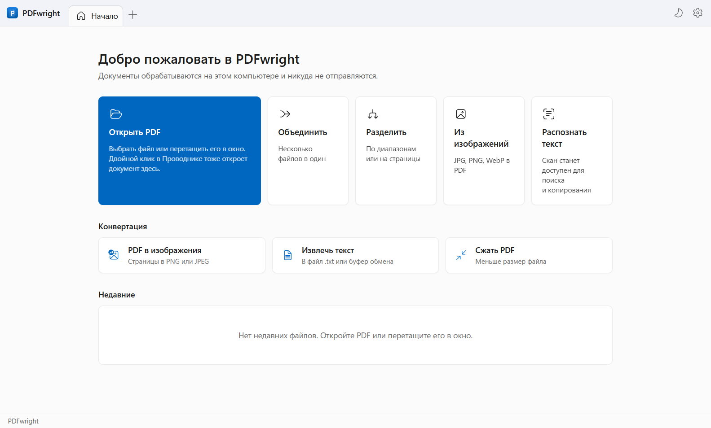

1. Запустите PDFwright без файла. Ожидается стартовый экран: «Открыть PDF», плитки «Объединить», «Разделить», «Из изображений», «Распознать текст», ниже «Конвертация» и «Недавние».
2. Откройте `Договор.pdf`, дважды щёлкнув его в Проводнике. Если PDFwright назначен программой по умолчанию, файл откроется в программе. Иначе выберите «Открыть с помощью → PDFwright».
3. Закройте вкладку, удалите копию файла и щёлкните его в «Недавних». Ожидается сообщение «Файл не найден» и кнопка «Убрать из «Недавних»», а не техническая ошибка.
4. Выделите в Проводнике два PDF и перетащите их на ярлык PDFwright. Оба должны открыться вкладками.

## 2. Просмотр

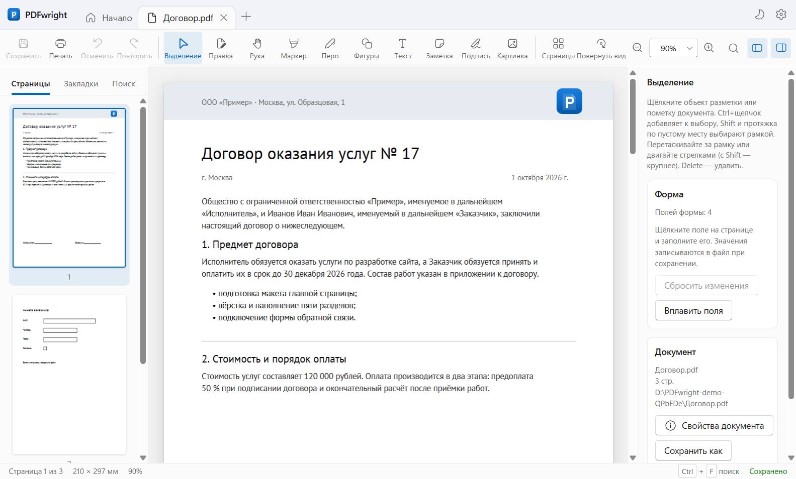

1. Слева миниатюры, справа панель свойств, внизу строка состояния. В строке состояния: «Страница 1 из 3 · 210 × 297 мм · масштаб · Сохранено». Заголовок окна в панели задач — «Договор.pdf — PDFwright».
2. Перейдите на страницу 3 (скан). Размер в строке состояния должен смениться на 210 × 148 мм.
3. Масштаб:
   - Ctrl + колесо мыши, Ctrl+«+», Ctrl+«−» и Ctrl+0 меняют масштаб;
   - поле масштаба принимает своё число, например 137, по Enter;
   - в меню рядом с полем есть «По ширине», «Страница целиком» и готовые значения.
4. «Повернуть вид» (Ctrl+R) поворачивает только отображение. Документ остаётся «Сохранено», миниатюры в режиме «Страницы» не поворачиваются.
5. Вкладка «Закладки»: у договора закладок нет, должно быть написано «В документе нет закладок.»

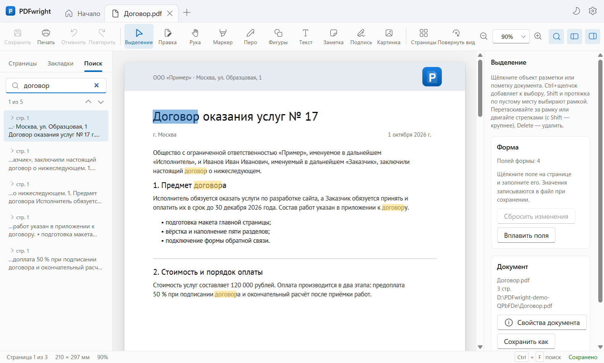

6. Ctrl+F, введите «договор» и нажмите Enter. Найденное подсвечивается, Enter и Shift+Enter переходят между совпадениями. Во фрагментах слова соседних строк не склеены. Esc убирает и результаты, и подсветку.
7. Параметры → Просмотр → «По одной». Колесо мыши, стрелки и пробел у края страницы листают на соседнюю.

## 3. Страницы

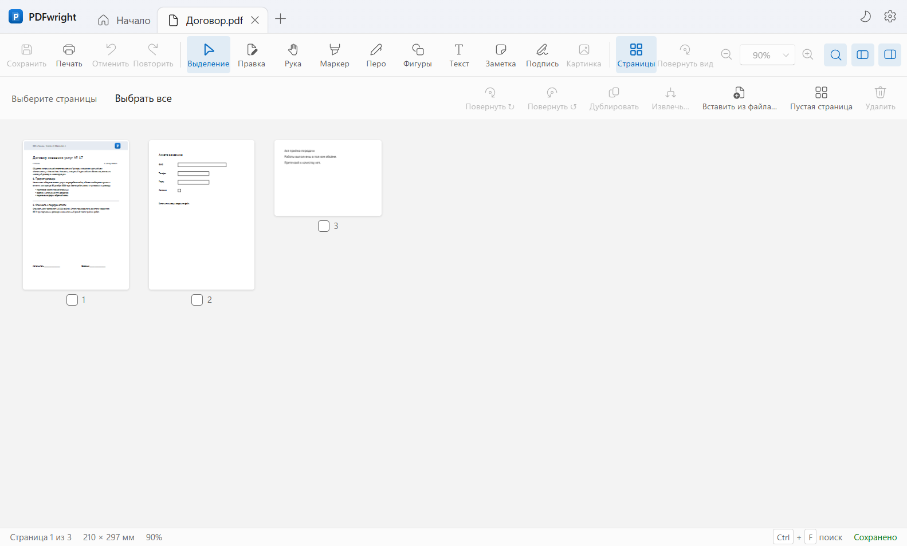

1. Ctrl+G открывает режим «Страницы». Работают выбор щелчком, с Ctrl и с Shift, а также Ctrl+A. Флажок выбора стоит под миниатюрой и не закрывает её.
2. Проверьте «Повернуть ↻/↺», «Дублировать», «Пустая страница», «Вставить из файла», перетаскивание страниц и Delete. Ctrl+Z отменяет каждое действие.
3. Выберите все страницы. Кнопка «Удалить» неактивна, рядом написано «Выбраны все — удалить нельзя».
4. «Извлечь…» сохраняет новый файл и не переключает на него: внизу появляется сообщение с кнопкой «Открыть».
5. «Инструменты → Разделить» дважды подряд в одну и ту же папку. Во второй раз файлы получают имена с « (2)», старые не перезаписываются.

   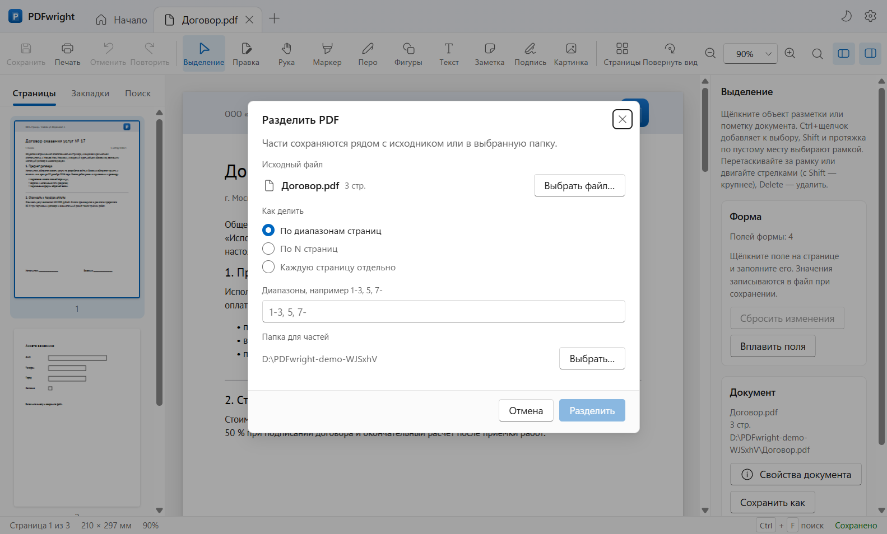

6. «Объединить»: добавьте два файла, поменяйте порядок кнопками «Выше» и «Ниже». Результат открывается сам.
7. Сохраните документ (Ctrl+S), закройте и откройте снова. Порядок, повороты и пустые страницы сохранились.

## 4. Разметка и подпись

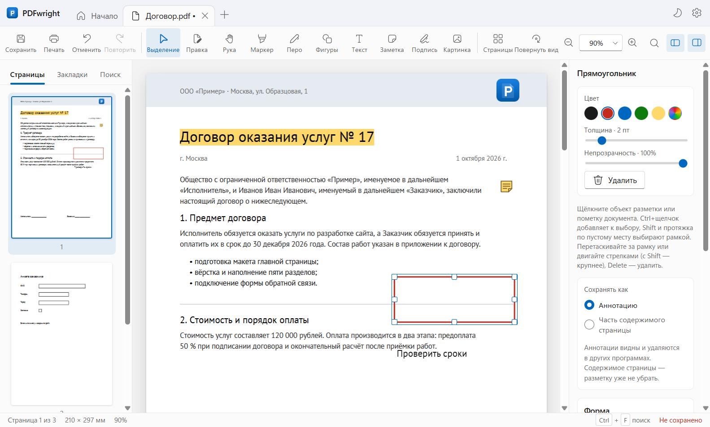

1. **Маркер:** проведите по заголовку, он подсветится жёлтым.
2. **Подчеркнуть и зачеркнуть:** выбираются в панели маркера. Цвет по умолчанию синий и красный соответственно.
3. **Фигуры:** нарисуйте прямоугольник. Чтобы его выбрать, достаточно щёлкнуть внутри. Стрелки двигают фигуру на 1 пт, с Shift — на 10 пт. За край страницы она не уходит.
4. **Текст:** щелчок по странице и набор текста. Длинная строка у правого края переносится по краю страницы. Если стереть весь текст в панели, блок удаляется.
5. **Заметка:** щелчок ставит значок, текст набирается во всплывающем окне. После сохранения заметка видна в других программах, например в Acrobat или Edge, в любом режиме сохранения.
6. В панели свойств выберите «Сохранять как»: «Аннотацию» (можно убрать в другой программе) или «Часть содержимого страницы» (вплавлено навсегда).
7. Миниатюра слева показывает разметку на тех же местах, что и на странице, ещё до сохранения.
8. Кнопки цвета подписаны («Синий», «Красный»), «Свой цвет…» открывает системную палитру.

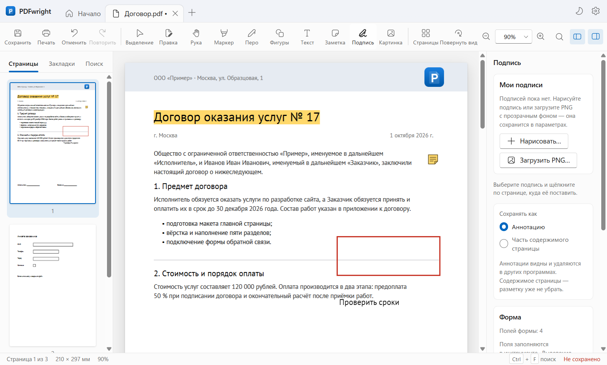

9. **Подпись:** «Нарисовать…». Одиночный щелчок ставит точку, подпись сохраняется в «Мои подписи», плитки не наползают друг на друга. Поставьте подпись на страницу. Картинку и подпись нельзя сжать меньше 16 пт.
10. Сохраните, закройте и откройте файл заново. Пометки на месте. В режиме «Выделение» пометки из файла можно выбрать, перенести, растянуть и удалить. Двойной щелчок по текстовой пометке открывает её правку, у линии из файла есть ручки на концах.

## 5. Правка содержимого документа

Здесь меняется сам документ, а не слой пометок поверх него.

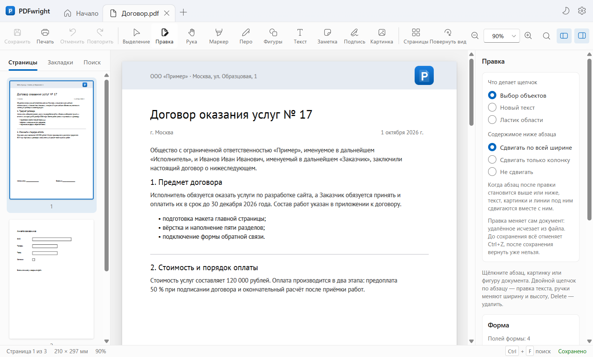

1. Нажмите «Правка». Справа появятся два переключателя. «Что делает щелчок»: «Выбор объектов», «Новый текст», «Ластик области». «Содержимое ниже абзаца»: «Сдвигать по всей ширине», «Сдвигать только колонку», «Не сдвигать».

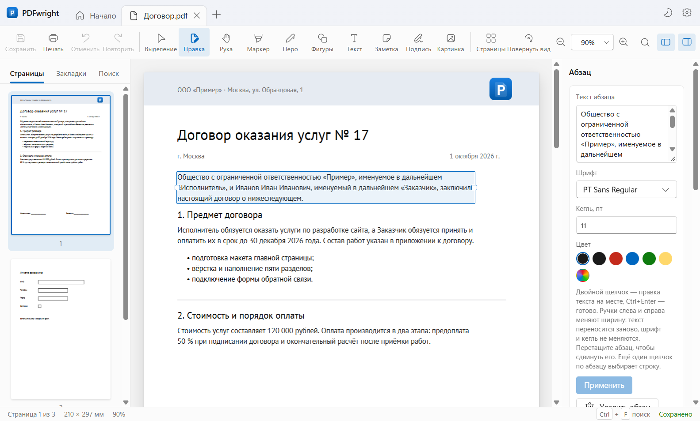

2. Щёлкните абзац: он выбирается целиком, справа появляются шрифт (понятное имя, например «PT Sans Regular»), кегль и цвет. Второй щелчок по выбранному абзацу выбирает строку.
3. Перетащите выбранный абзац за любую его строку: он переносится. Если щёлкнуть без движения, выбирается строка.
4. Выберите красный цвет абзаца. Перекрашиваются все буквы, в том числе жирные слова (проверьте на своём файле с жирным словом в строке).

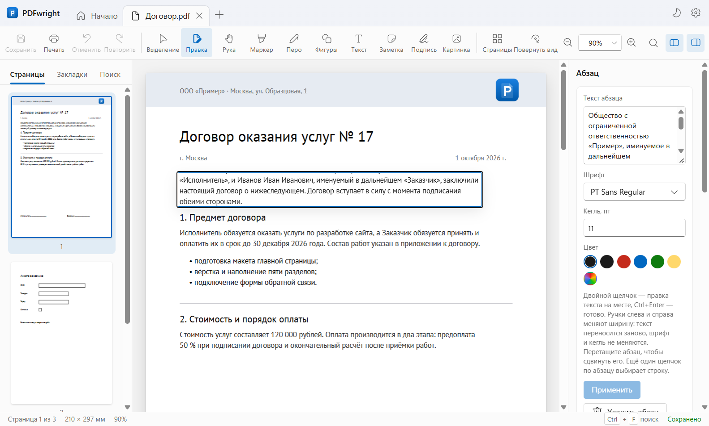

5. Двойной щелчок по абзацу открывает правку на месте. Допишите предложение и нажмите Ctrl+Enter. Esc отменяет правку.

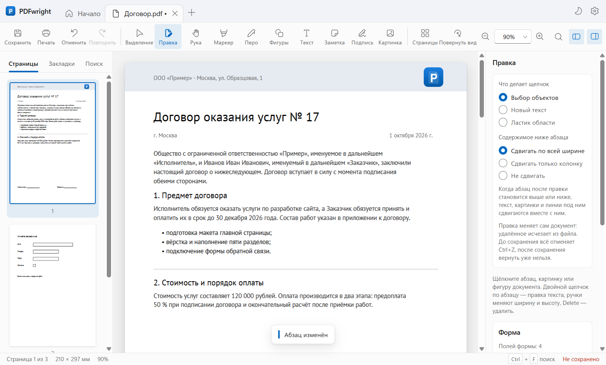

6. Абзац вырос на строку, и всё ниже опустилось вместе с ним: заголовок, список, линия. Строка подписей внизу страницы осталась на месте.
7. Допишите в абзац очень много текста, на полстраницы. Должна появиться ошибка «Абзац не помещается: ниже на странице не хватает места…», а документ не меняется.
8. Ctrl+F «Образцовая» должен найти 1 совпадение. Раньше сдвиг оставлял в файле скрытые копии, и находилось несколько.
9. Удалите абзац клавишей Delete: текст ниже поднимается. Выберите два абзаца (Ctrl+щелчок) и удалите их вместе: текст ниже тоже поднимается.
10. Ручки слева и справа у выбранного абзаца меняют ширину: строки переносятся заново, шрифт и кегль не меняются.

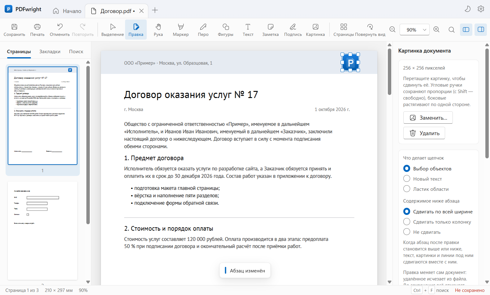

11. Щёлкните логотип в шапке. Его можно перенести, растянуть за угол (пропорции сохраняются, с Shift — свободно), заменить («Заменить…») и удалить. Так же правятся плашка шапки и линия.

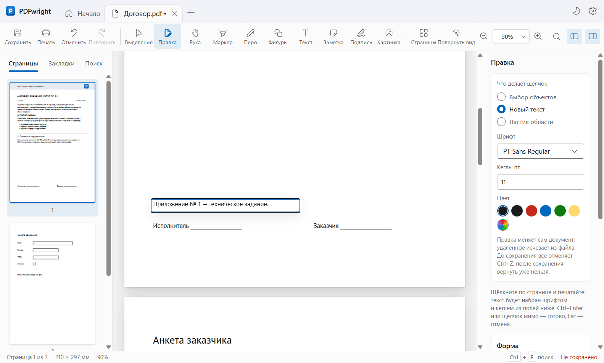

12. «Новый текст»: щёлкните под последним абзацем и печатайте. Поле растёт по тексту. Ctrl+Enter или щелчок мимо применяют. Текст набирается шрифтом документа. Если в шрифте документа нет буквы, например «Ё» или «Щ», она берётся из похожего шрифта того же начертания, а не из Helvetica.
13. «Ластик области»: обведите часть строки, и она вырезается из файла (поиск её больше не находит).
14. Ctrl+Z отменяет каждую правку по шагу. После сохранения отменить уже нельзя, об этом сказано в панели.

## 6. Ваше резюме (на копии)

Снимков здесь нет: в резюме личные данные.

1. Откройте копию резюме и нажмите «Правка».
2. **Изменить текст:** двойной щелчок по абзацу опыта работы, поправьте фразу, Ctrl+Enter. Шрифт и кегль остаются как в документе, жирные слова остаются жирными, текст ниже сдвигается, нижний колонтитул «Резюме обновлено…» остаётся на месте.
3. **Удалить строку:** щелчок по абзацу, второй щелчок по строке, Delete.
4. **Удалить шапку:** щёлкните фото или плашку шапки и нажмите Delete. Текст шапки удаляется по абзацам или ластиком.
5. **Добавить текст:** «Новый текст», щелчок рядом с левым краем абзаца (новый текст прилипает к краю). В панели шрифт документа, например «Go Noto Current Regular», и нужный кегль.
6. Сохраните, закройте и откройте файл снова. Откройте его и в другой программе (Edge, Acrobat): текст выделяется и ищется, лишних копий нет.

## 7. Формы

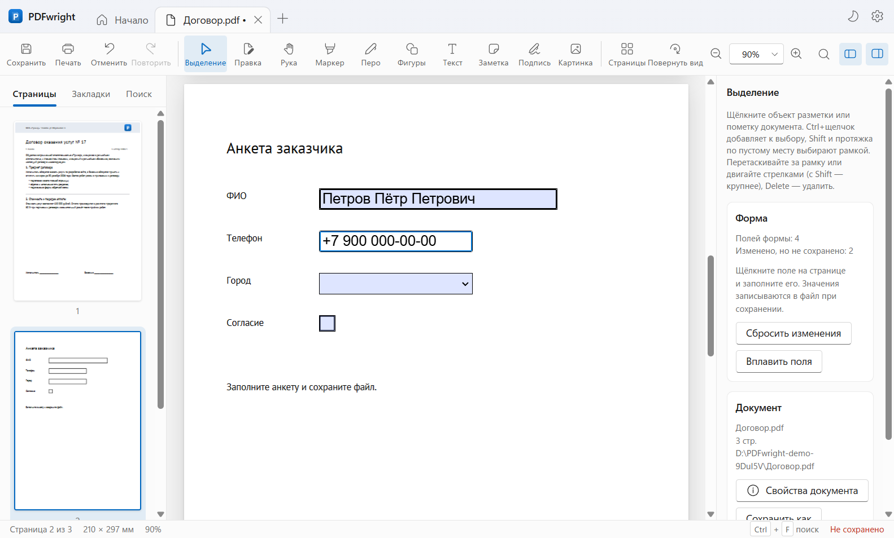

1. На странице 2 заполните ФИО и телефон, выберите город, поставьте флажок. В панели «Форма» показано «Изменено, но не сохранено: N».
2. Ctrl+Z в поле отменяет ввод с первого нажатия.
3. Если поставить и снять флажок, это не считается правкой: статус возвращается к «Сохранено». Так же статус возвращается, если отменить все правки.
4. Нижние части букв «у», «р» в полях не обрезаются.
5. «Вплавить поля» превращает значения в обычный текст страницы. После сохранения в других программах полей больше нет.

## 8. Свойства и пароль

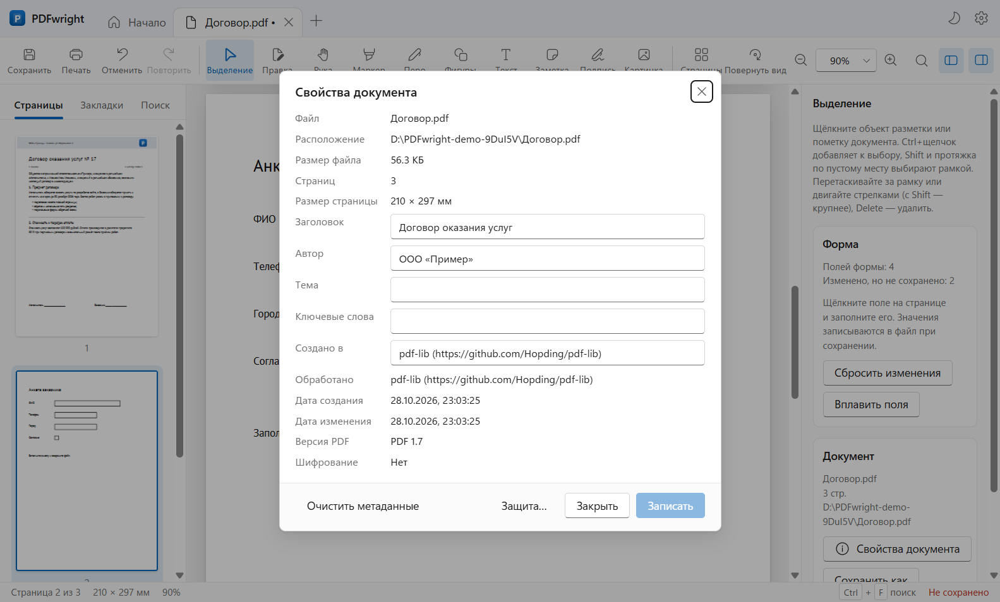

1. «Свойства документа»: название, автор и другие поля. Измените и нажмите «Записать», затем сохраните документ. Повторное открытие свойств показывает новые значения, шифрование — без надписи «будет записано при сохранении».

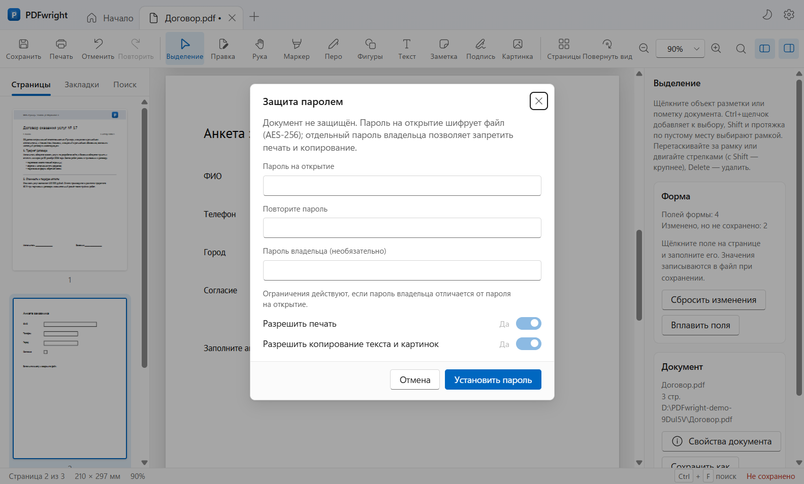

2. «Файл → Защита паролем…»: задайте пароль на открытие и отдельный пароль владельца, запретите печать и копирование. Сохраните документ.
3. Откройте файл заново. Программа спрашивает пароль. Если ввести пароль на открытие, печать и копирование запрещены с понятным сообщением. Если ввести пароль владельца, ограничений нет.
4. «Сменить пароль»: если оставить новый пароль владельца пустым, прежний пароль владельца и запреты сохраняются. Неверный пароль владельца даёт сообщение «Это не пароль владельца документа.»
5. «Снять защиту» с паролем владельца: после сохранения файл открывается без пароля.

## 9. Конвертация, распознавание, сравнение

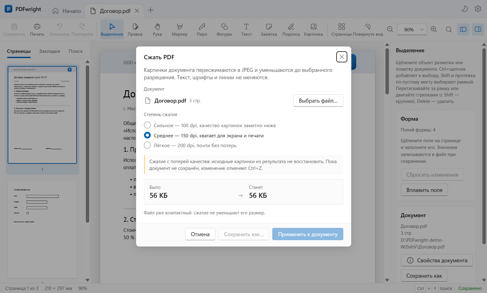

1. «Сжать PDF»: показывает ожидаемый выигрыш. Если выигрыш меньше 1 %, применять нечего. Выбранная степень сжатия запоминается.

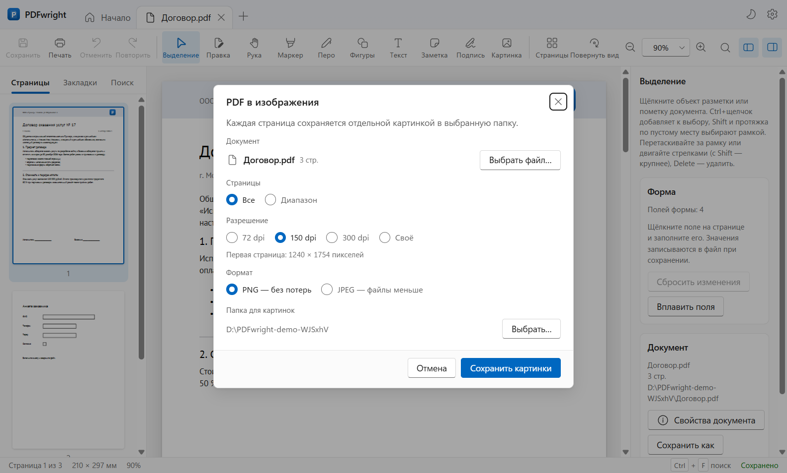

2. «PDF в изображения» дважды в одну папку. Во второй раз имена с « (2)», ничего не перезаписано.
3. «Из изображений» (плитка на стартовом экране): маленькая картинка встаёт в центр A4 в своём размере и не растягивается.
4. Конвертация зашифрованного файла через «Выбрать файл…» спрашивает пароль. Повреждённый файл даёт «Файл не является PDF или повреждён.»

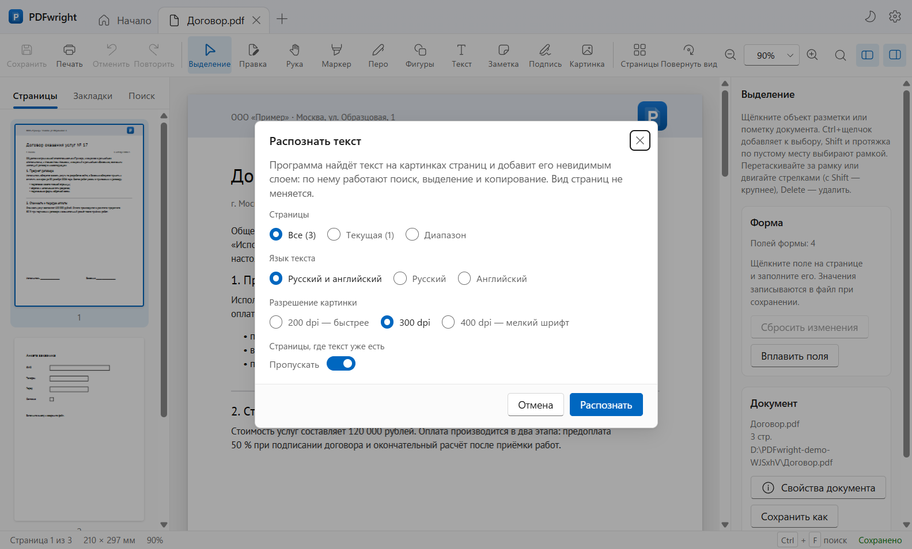

5. «Распознать текст» (плитка на стартовом экране или кнопка в панели «Документ») на странице 3 договора. После распознавания поиск находит «Акт приёма-передачи», текст выделяется и копируется. Если включить «Распознавать тоже» для страниц, где текст уже есть, диалог предупреждает о дублях.

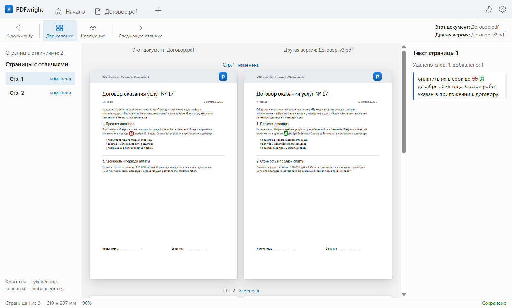

6. В панели «Документ» нажмите «Сравнить с…» и выберите `Договор_v2.pdf`. Отличия на страницах 1 («30» → «31») и 2. «Следующее отличие» начинает с текущей страницы. Строка состояния показывает страницу сравнения. «Анкету» и «анкету,» не считаются разными словами, отдельно отмечается только запятая.

## 10. Окна, параметры, язык

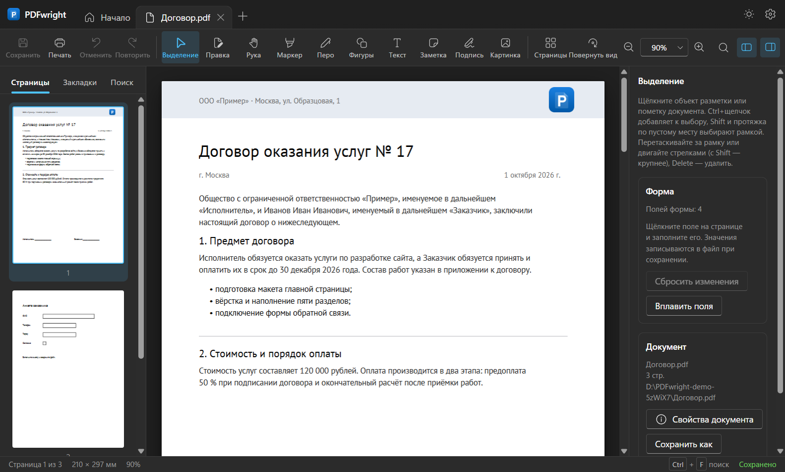

1. Тёмная тема: кнопка с луной вверху справа. Все экраны читаются.
2. Правый щелчок по вкладке → «Открыть в новом окне». У двух окон в панели задач разные заголовки.
3. Закройте окно с несохранёнными правками: программа предлагает «Отмена», «Не сохранять» и «Сохранить».
4. Закройте программу с двумя окнами и откройте снова. Окна и вкладки восстановились.

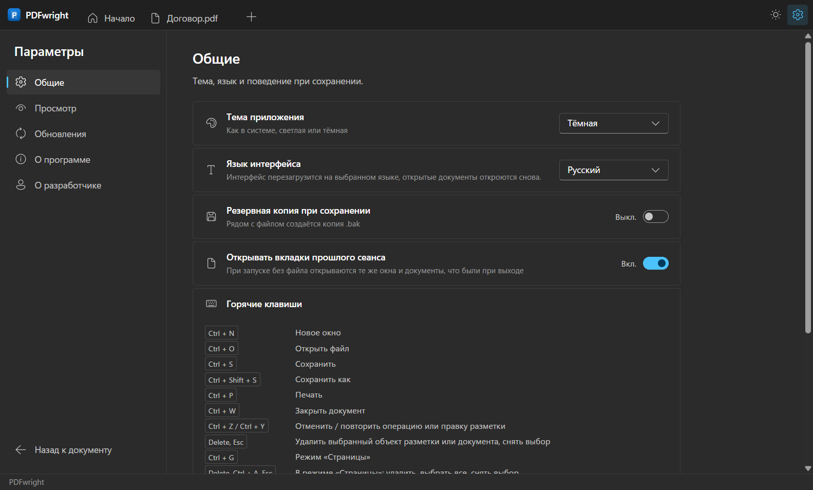

5. Параметры → «Язык интерфейса» → English. Интерфейс перезагружается на английском, документы открываются снова. «Лицензии и приватность» показывает отрисованный текст (заголовки, таблицы) на английском. «Copy diagnostics» тоже на английском. Верните русский.
   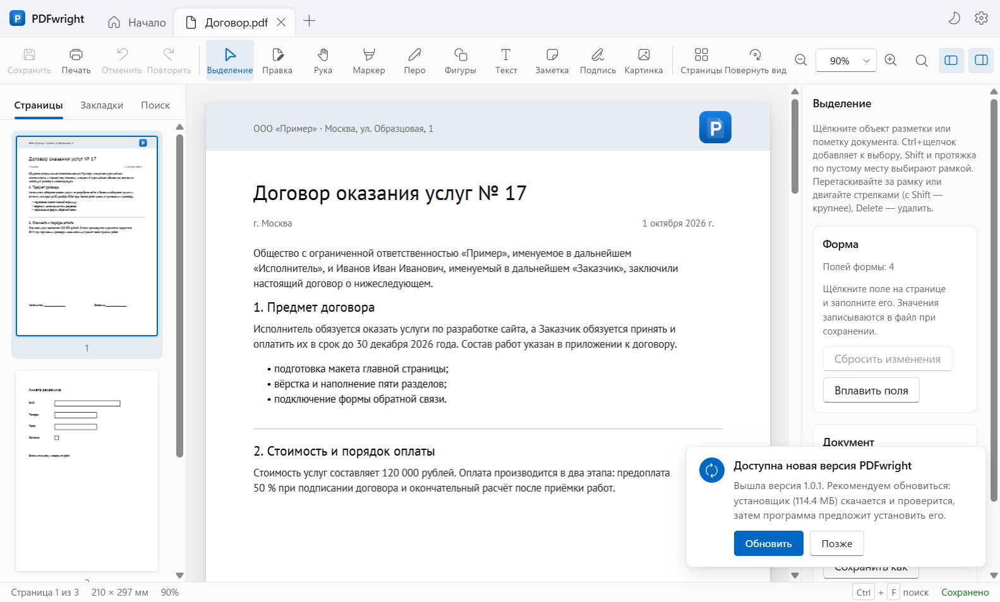

6. «О программе»: версия, «Windows x64». «Обновления» → «Проверить обновления» в установленной версии обращается к GitHub. «Проверять обновления автоматически» включено: когда выйдет версия новее установленной, примерно через 10 секунд после запуска в правом нижнем углу появится «Доступна новая версия PDFwright» с кнопками «Обновить» и «Позже».
   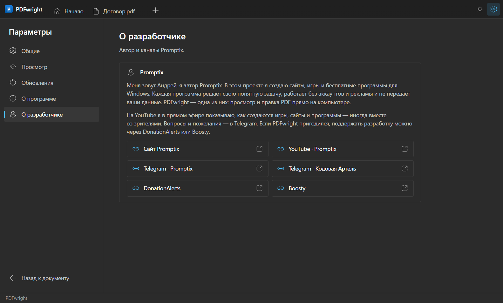

7. «О разработчике»: текст об авторе Promptix и ссылки на сайт, YouTube, Telegram, DonationAlerts и Boosty.
8. На вкладке «Начало» строка состояния не показывает данные скрытого документа.

## 11. Удаление программы

1. «Параметры Windows → Приложения → PDFwright → Удалить». Программа удаляется, ярлыки исчезают.
